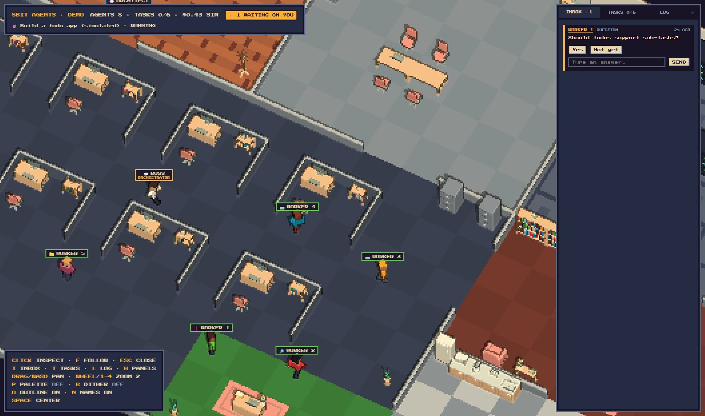

# 8Bit Agents

[](https://github.com/ghostbytestudios/8-bit-agents/actions/workflows/ci.yml)
[](https://github.com/ghostbytestudios/8-bit-agents/releases/latest)
[](LICENSE)

A pixel-art office where AI agents plan, build and test your project while you watch.

Give the team a goal. The Architect sketches a plan on the whiteboard, the Boss hands out tasks, and
Workers build at their desks. You see every step and answer their questions in your inbox.



**[Try the demo in your browser](https://ghostbytestudios.github.io/8-bit-agents/)** · **[Download](https://github.com/ghostbytestudios/8-bit-agents/releases/latest)**

## Download

| System  | File                         |
| ------- | ---------------------------- |
| Windows | `8Bit-Agents-Setup.exe`      |
| macOS   | `8Bit-Agents-mac.dmg`        |
| Linux   | `8Bit-Agents-linux.AppImage` |

Early builds aren't code-signed yet. On Windows choose **More info › Run anyway**. On macOS open the app
once, then go to **System Settings › Privacy & Security** and choose **Open Anyway**.

## Use any model

Pick a model for each role: a strong one for the Boss and Architect, a quick one for the Workers.

- Claude, OpenAI, OpenRouter, Groq, or any OpenAI-compatible server
- Ollama or LM Studio for free models on your own computer

You need an API key from a provider (or a local model). Claude Pro and ChatGPT Plus subscriptions
don't include API access.

## Safety

- **Keys stay on your computer**, encrypted with your system keychain, and are only sent to their provider.
- **One folder:** agents can only read and write inside the workspace folder you choose.
- **You approve commands:** every shell command waits in your inbox for your OK.
- **Spending limits:** each run stops at the dollar and token limits you set.
- **No account, no analytics.** See the [privacy page](https://ghostbytestudios.github.io/8-bit-agents/privacy.html).

## Development

Needs Node 24 or newer.

```bash
npm install
npm run server     # local agent server on 127.0.0.1:8787
npm run dev        # the office in your browser (open http://localhost:5173)
npm run desktop    # or the desktop app
```

Open `http://localhost:5173/?mock` to watch pretend agents without a server or API key.

| Command                | What it does                                |
| ---------------------- | ------------------------------------------- |
| `npm test`             | all tests                                   |
| `npm run typecheck`    | type-check every package                    |
| `npm run desktop:dist` | build the installer for your system         |
| `npm run site`         | build and preview the website with the demo |

### Layout

| Folder              | What's inside                                                 |
| ------------------- | ------------------------------------------------------------- |
| `apps/client`       | the office: Three.js scene, pixel effects, HUD                |
| `apps/server`       | the agent server: runs, providers, tools, settings            |
| `apps/desktop`      | the Electron app around the client and server                 |
| `apps/site`         | the website and its playable demo                             |
| `packages/protocol` | the event and command formats shared by everything else       |

### Releasing

1. Bump `version` in `apps/desktop/package.json` and add notes to `apps/desktop/src/whatsNew.ts`.
2. Push a tag with the same version, for example `v0.2.0`.
3. GitHub Actions builds the three installers into a draft release. Check it, then publish.

## Contributing

Bug reports, ideas and pull requests are welcome. See [CONTRIBUTING](.github/CONTRIBUTING.md) to get
started, and the [security policy](.github/SECURITY.md) to report a vulnerability privately.

## Credits

Furniture models by [Kenney](https://kenney.nl) (CC0). Font: Press Start 2P (SIL Open Font License).

## License

© 2026 Ghostbyte Studios. 8Bit Agents is free software: you can share and change it under the
[GNU General Public License v3.0 or later](LICENSE). Art and fonts keep their own licenses, listed above
and in `apps/client/public/assets/CREDITS.json`.
